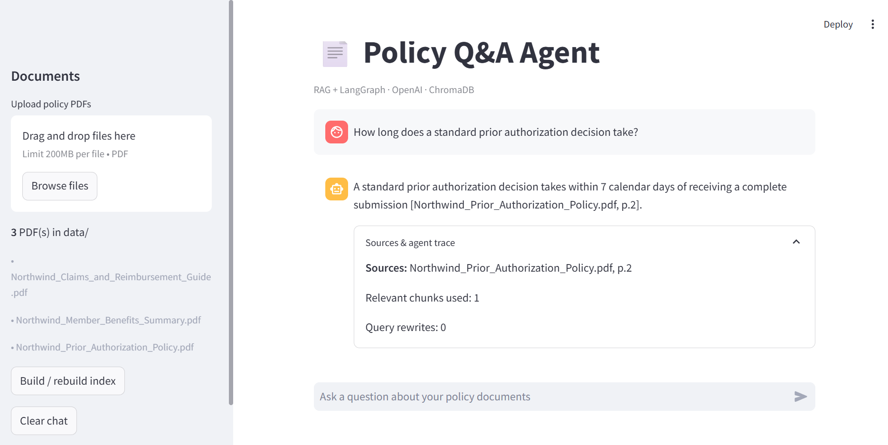
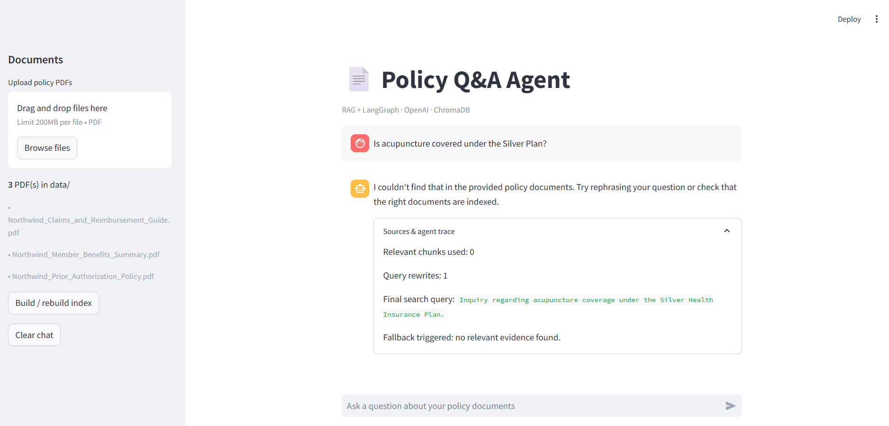
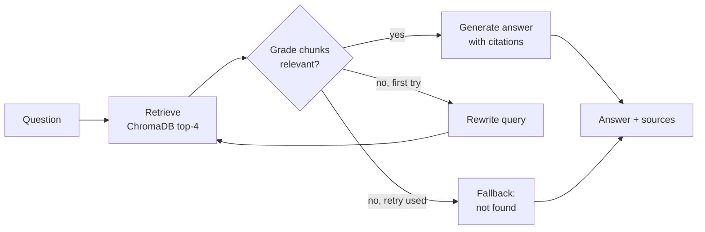

# 📄 Policy Q&A Agent (RAG + LangGraph)

An agentic RAG app that answers questions about policy documents with **source citations**. Instead of pasting retrieved text straight into a prompt, a LangGraph workflow **grades** the retrieved passages, **rewrites** the search query when retrieval fails, and **declines to answer** when the documents don't contain the answer.




## Features
- Answers questions over PDF policy documents, citing the file and page for every claim (`[file.pdf, p.2]`)
- Grades retrieved chunks for relevance before answering, so off-topic text never reaches the answer
- Rewrites the query once and retries when nothing relevant is found
- Refuses out-of-scope questions instead of guessing
- Streamlit chat UI with a **Sources & agent trace** panel (sources, relevant chunks, query rewrites, fallback)
- Upload PDFs and rebuild the index from the app
- Evaluation script with a 30-question test set

## How it works



1. **Ingest** – PDFs are split into 1000-character chunks (150 overlap), embedded with OpenAI `text-embedding-3-small`, and stored in ChromaDB.
2. **Retrieve** – the 4 most similar chunks are fetched.
3. **Grade** – the LLM checks each chunk with structured output. A chunk passes only if it states a fact the question needs, not just because it shares the topic.
4. **Rewrite** – if nothing passes, the query is rewritten once and retrieval is retried.
5. **Generate or decline** – answers use only graded chunks and cite their sources. If the documents don't state the answer, the agent says so.

## Tech stack
Python · LangGraph · LangChain · OpenAI (`gpt-4o-mini`) · ChromaDB · Streamlit · Docker

## Quickstart

```bash
pip install -r requirements.txt
cp .env.example .env            # Windows: copy .env.example .env, then add your OPENAI_API_KEY
python ingest.py                # build the vector index from data/
streamlit run app.py            # chat UI at http://localhost:8501
```

Terminal chat is also available: `python agent.py`

Docker:
```bash
docker build -t policy-qa-agent .
docker run -p 8501:8501 --env-file .env -v "$(pwd)/data:/app/data" policy-qa-agent
```

**Tips**
- On Windows, if `streamlit` isn't recognized, use `python -m streamlit run app.py`.
- Keep the project outside OneDrive-synced folders. Syncing can lock the `chroma_db/` folder while indexing.
- Never commit your `.env` file. It is git-ignored.

## Sample data
`data/` contains three **fictional** documents from an invented insurer, "Northwind Health Plan": a prior authorization policy, a member benefits summary, and a claims and reimbursement guide. They are synthetic, so they are safe to publish. Add your own PDFs to `data/` and re-run `python ingest.py` to use real documents.

## Evaluation

`evaluate.py` runs `eval_questions.json` through the agent: 24 answerable questions (including paraphrased, multi-part, and near-miss questions that overlap across documents) and 6 out-of-scope questions.

```bash
python evaluate.py
```

| Metric | Result |
|---|---|
| Answerable questions correct | 24/24 |
| Answers with source citations | 24/24 |
| Out-of-scope questions declined | 6/6 |
| Questions that needed a query rewrite | 6/30 |
| Average latency | 1.9 s |

Answerable questions pass when the answer contains the expected key facts. Out-of-scope questions pass when the agent falls back or says the documents don't specify the answer.

### Findings
- The first full run scored 29/30. The one failure was an out-of-scope question about the deadline to appeal an external review decision. The agent answered with a deadline from a different process (a related-topic passage passed grading).
- **Fix:** the grader now requires a passage to state the specific fact needed, and the answer prompt must say the documents don't specify it rather than substitute a related rule.
- **Re-run:** 30/30. Because the prompts were tuned after seeing that failure, this set is not a fully independent test. The test set is also small and built from short documents.

## Project structure
```
agent.py                 LangGraph workflow: retrieve, grade, rewrite, generate, fallback
ingest.py                PDF loading, chunking, embeddings, ChromaDB indexing
app.py                   Streamlit chat UI with sources and agent trace
evaluate.py              Evaluation harness
config.py                Models, chunking, and retrieval settings
eval_questions.json      30-question test set
data/                    Sample policy PDFs
docs/                    README screenshots
```

## Design decisions
- **Grading step:** reduces hallucination by keeping off-topic chunks out of the answer prompt.
- **One query rewrite:** improves recall for vaguely worded questions while capping cost and latency.
- **Refusal is a feature:** declining is tested explicitly, with out-of-scope questions in the evaluation set.
- **Settings in one place:** models, chunk size, top-k, and retry count live in `config.py`.
- **Secrets stay out of code:** the API key is read from `.env`, which is git-ignored along with the vector store.

## Limitations and future work
- Text-based PDFs only, with no OCR for scanned documents
- Hybrid search (BM25 plus vectors) and a reranker
- Questions that compare or combine many documents
- Token and cost tracking per query
- A larger, independently written evaluation set
